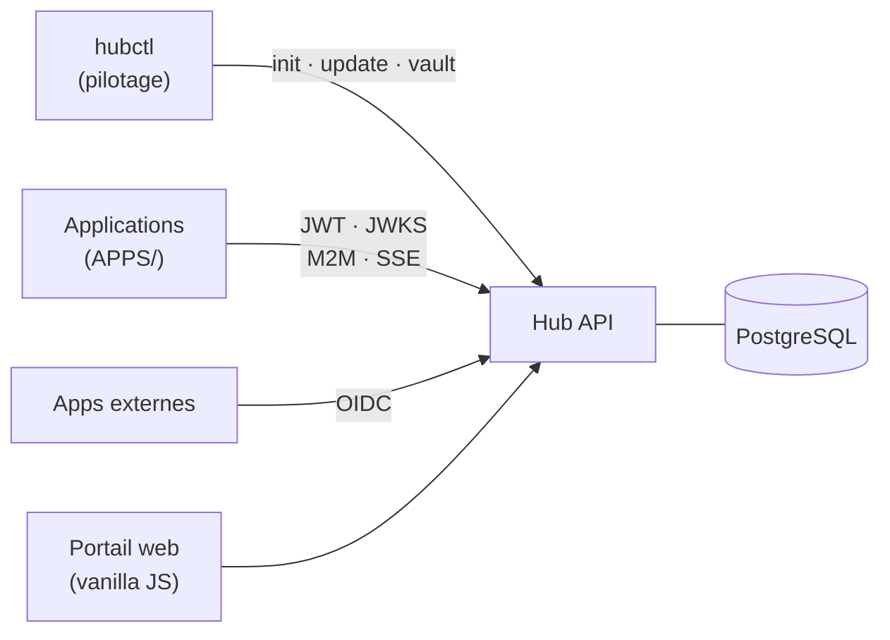

# HUB_base — Hub central POULIDOR


Portail central du parc POULIDOR : **authentification SSO**, registre des applications,
messagerie, sauvegardes et administration. Toutes les applications du parc s'y
authentifient et y trouvent leurs services communs — l'alternative légère et maîtrisée
à Keycloak/Authentik.

**Stack :** FastAPI (async, SQLAlchemy 2) · PostgreSQL 16 · Frontend vanilla JS
(Bootstrap 5, ECharts — servi tel quel, sans build) · Docker Compose

---

## Ce que fait le Hub

- **Authentification SSO** — tokens JWT signés **RS256** (clés asymétriques RSA), JWKS
  public que les apps vérifient sans couplage. Trousseau multi-clés avec **rotation sans
  rupture** et révocation (overlap 24 h), TOTP self-service pour la récupération de mot
  de passe.
- **Provider OIDC complet** — discovery (`/.well-known/openid-configuration`), authorize /
  token / userinfo / refresh, back-channel logout, SLO poste partagé : le Hub sert de
  fournisseur d'identité pour des apps externes (Vikunja, Grafana…).
- **Registre des applications** — enregistrement des apps, rôles par app (Viewer →
  Admin), catégories, favoris, sync avec Docker.
- **Interop M2M** — service accounts scopés par app, découverte de services, catalogue
  d'endpoints, outbox avec retry (livraison garantie des messages inter-apps).
- **Messagerie & notifications** — messages ciblés ou broadcast, templates,
  planification + flux **SSE** temps réel par utilisateur.
- **Sauvegardes** — backup ZIP par application (planification cron, mot de passe,
  quiesce DB) et **snapshots complets chiffrés du Hub** (pg_dump + secrets + config),
  export S3/MinIO optionnel, restauration bare-metal.
- **Santé & pilotage** — health checks des apps, vérification de compatibilité socle,
  scan du socket Docker, audit (logs, sessions actives, KPIs d'usage).
- **Atelier & déploiement** — cycle atelier (workshop) pilotable depuis l'UI, déploiement
  d'apps depuis un repo Git, catalogue GitHub.
- **Réseau & sécurité** — PKI interne auto-générée (HTTPS dual-stack :80/:443), serveur
  **WireGuard VPN** intégré, whitelist réseaux, allocation de ports et sous-réseaux apps.

## Place dans le parc



- Les apps vérifient les tokens avec le JWKS public (`/api/auth/.well-known/jwks.json`)
  — zéro secret partagé, une app compromise ne peut pas forger de tokens.
- Le parc se pilote via [`hubctl`](https://github.com/POULIDOR-Audit-Developpement/Hubctl)
  ; le design system servi aux apps vient de
  [`HUBCSS`](https://github.com/POULIDOR-Audit-Developpement/HUBCSS).
- Dépôts voisins : [HUBsocle](https://github.com/POULIDOR-Audit-Developpement/HUBsocle) ·
  [HUBapp_TEMPLATE_base](https://github.com/POULIDOR-Audit-Developpement/HUBapp_TEMPLATE_base) ·
  [hub-mcp](https://github.com/POULIDOR-Audit-Developpement/hub-mcp)

## Démarrage

### Installation tout-en-un (recommandée)

```bash
sudo ./install.sh                 # auto : secrets générés, .env chmod 600, compose up + healthcheck
# variantes : --interactive | --profile client.json (voir docs/hub-profile.example.json)
```

Le script affiche l'URL du Hub et le mot de passe admin auto-généré. Depuis la racine du
parc, l'équivalent est `./hubctl init`.

### Opérations courantes

```bash
make build        # construire les images
make up-prod      # démarrer (compose + override si présent)
make up-dev       # démarrer en mode dev (reload, logs verbeux)
make logs         # suivre les logs
make test         # suite de tests (parallèle, SQLite en mémoire)
make test-docker  # tests sur stack compose isolée (-p pouly-test)
```

> Le Hub doit être démarré **avant** les applications. Prérequis : Docker ≥ 24, 2 Go RAM
> (détail dans `docs/GUIDE_INSTALLATION.md`).

## Configuration

Toute la configuration passe par `.env` (voir `.env.example`) : PostgreSQL, admin,
ports, JWT, PKI, OIDC, rétentions, réseau Docker (pool sous-réseaux apps), sync Docker…
Les secrets runtime vivent dans `secrets/` (gitignoré) ; la PKI est générée au premier
boot (`hub/pki.py`).

## Structure

```
HUB_base/
├── hub/            ← Backend FastAPI : app/, routes/ (23 routeurs), migrations/, tests/
├── frontend/       ← SPA vanilla JS servie par nginx (public/, js/modules/)
├── docs/           ← Guides : installation, admin, architecture, HTTPS, cahier des charges
├── scripts/        ← gen-secrets.sh, migration secrets legacy
├── secrets/        ← clés JWT + service accounts (gitignoré)
├── certs/          ← PKI interne (CA + cert serveur, générés au 1er boot)
└── storage/        ← backups applicatifs + snapshots du Hub
```

## Pour aller plus loin

| Document | Contenu |
|----------|---------|
| [`INTEGRATION.md`](INTEGRATION.md) | **Guide d'intégration des apps** (JWT, M2M, OIDC) — servi aussi via `/api/docs/integration` |
| [`docs/GUIDE_ADMIN.md`](docs/GUIDE_ADMIN.md) | Opérations courantes : utilisateurs, rôles, apps |
| [`docs/GUIDE_INSTALLATION.md`](docs/GUIDE_INSTALLATION.md) | Installation détaillée sur serveur client |
| [`docs/ARCHITECTURE.md`](docs/ARCHITECTURE.md) | Architecture interne (nginx, API, DB) |
| [`docs/HTTPS.md`](docs/HTTPS.md) | HTTPS dual-stack, CA interne, permissions clés |
| [`docs/CAHIER_DES_CHARGES.md`](docs/CAHIER_DES_CHARGES.md) | Spécification fonctionnelle complète |
| [`BACKUP.md`](BACKUP.md) | Système de snapshots complets (contenu, S3, restauration) |
| [`SECURITY_AUDIT.md`](SECURITY_AUDIT.md) | Audit de sécurité HUB + template |
| [`how2endpoint.md`](how2endpoint.md) | Déclarer ses endpoints métier au Discovery Explorer |

## Versionnage

`VERSION` fait foi (actuellement 3.80.4), synchronisée dans le frontend par
`sync_version.py`. Historique : [`CHANGELOG.md`](CHANGELOG.md).

---

Distribué sous licence **GNU AGPLv3** — voir [`LICENSE`](LICENSE). Le nom « HUB » et les logos ne sont pas couverts par la licence (politique de marque du méta-repo POULIDOR).
